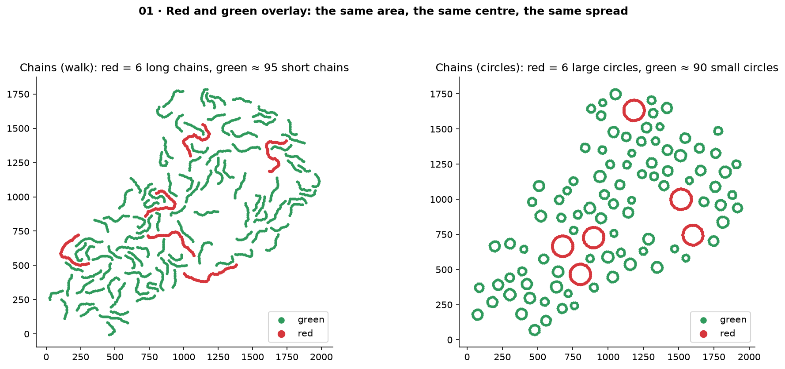
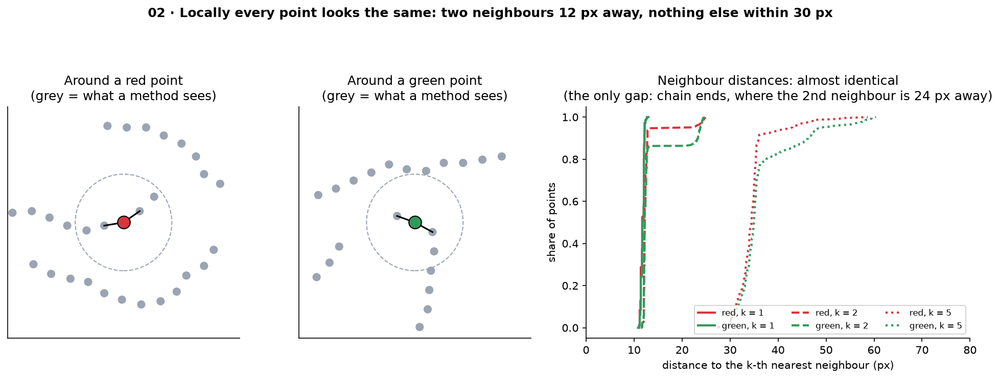
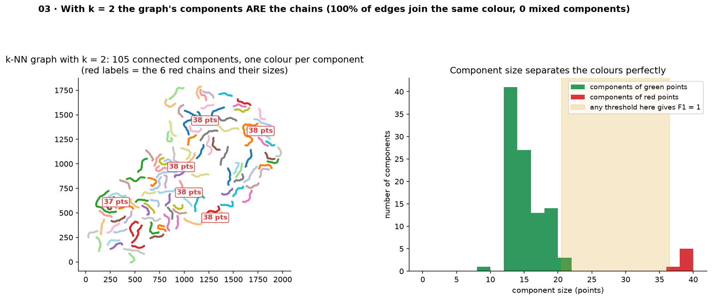
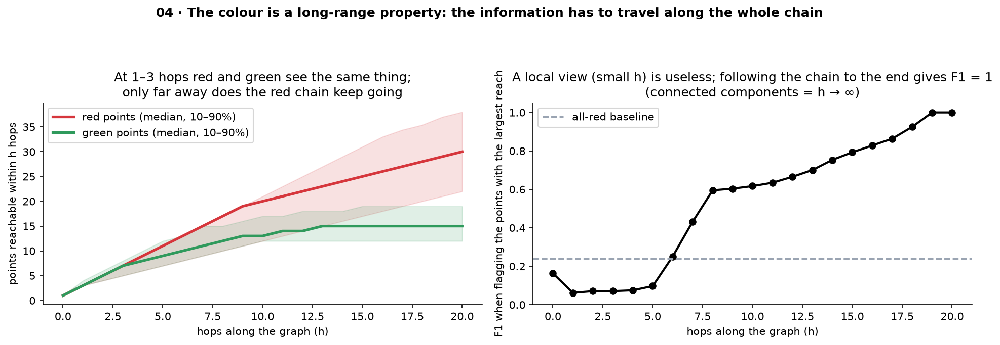
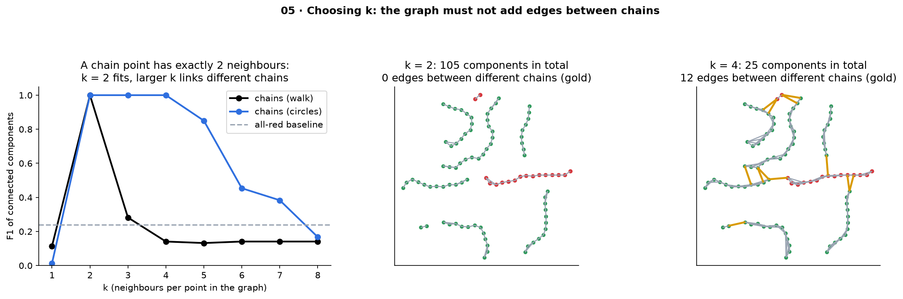
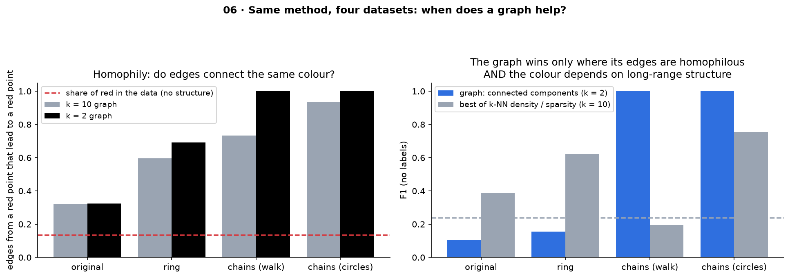
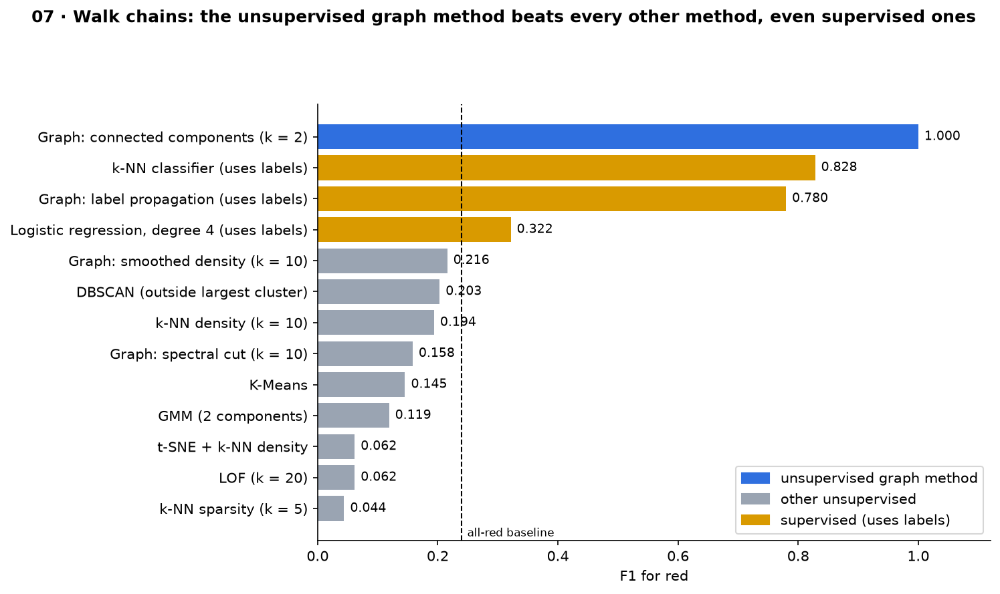

# Why the graph method works: illustrations

**[English](#english) · [Русский](#русский)**

All figures are generated from the CSV files in the repository root:

```bash
python illustrations/make_illustrations.py      # about 5 s, rewrites the PNG files
```

---

<a id="english"></a>

## English

The question: why does an **unsupervised** graph method (connected components of a k-NN graph) get a perfect F1 = 1.000 on the chain datasets, beating every other method, supervised ones included, while on the original and ring datasets graphs do not help at all? The seven figures answer it step by step.

### 01 · The data: red and green really overlay



- **Walk chains** (`df_red_green_chains.csv`): red = 6 long chains of ~38 points, green ≈ 95 short chains of 12–20 points.
- **Circles** (`df_red_green_circles.csv`): red = 6 large circles of ~38 points, green ≈ 90 small circles of 12–20 points.

In both, red is spread over the whole area. The class centres differ by 0.02–0.19σ and the spreads are similar, so methods that look at *where* points are (K-Means, GMM, spectral cuts) have nothing to work with.

### 02 · Locally, every point looks the same



Take any point and look around it with the colours hidden: two neighbours 12 px away along a line, and nothing else within 30 px. That is true for red and green alike, and the neighbour-distance curves on the right are almost identical.

The only difference is at **chain ends**, where the 2nd neighbour is 24 px away. 13.7% of green points are ends against 5.3% of red points, because short chains have relatively more ends. That hint is weak: no local method gets above 0.25 from it. Circles have no ends at all (0% for both colours).

So any method that judges a point by its **neighbourhood** sees the same picture for both colours: k-NN density, LOF, a classifier on X, Y, even supervised k-NN with 15 neighbours.

### 03 · With k = 2, the graph's components are exactly the chains



Link every point to its 2 nearest neighbours. The step along a chain (12 px) is smaller than the gap between chains (30 px), so a point's 2 nearest neighbours are always its own chain neighbours:

- **100% of the edges join points of the same colour**, and not a single component mixes colours (both chain datasets).
- The graph falls apart into ~105 connected components, one per chain.
- **Component size separates the colours perfectly:** green components have 8–22 points, red ones 37–38. Any threshold in the gold band gives F1 = 1.

### 04 · The colour is a long-range property



How many points can a point reach in h hops along the graph?

- **h = 1–3 hops:** red and green reach the same number (3, 5, 7…), because locally they are identical.
- **Beyond ~6 hops:** green chains end (they have 12–20 points), while red chains keep going up to 38.
- **Right panel:** flagging the points with the largest reach gives F1 *below* the all-red baseline for h ≤ 5, rises after 6–8 hops, and reaches 1.000 at about 19 hops, the length of half a red chain. Connected components are the limit h → ∞.

This is the core of the explanation. The information that decides the colour is not near the point; it is at the end of its chain. A method has to **follow the chain all the way**. Graph traversal does exactly that, while any fixed-radius method cannot.

It also explains why GCN-style averaging (smoothed density, SGC) does worse here. Averaging mixes values and fades after a few hops, whereas following edges is transitive: a point in the middle of a red chain is linked to all 38 points, however far away they are.

### 05 · Choosing k: the graph must not add edges between chains



A chain point has exactly 2 neighbours, so **k = 2 matches the structure**: 0 edges between different chains.

- **Walk chains:** at k = 3–4, extra edges jump to other chains (gold lines), components merge (105 → 25), and F1 collapses to 0.28 → 0.14.
- **Circles** tolerate k up to 4, because the extra edges cross *inside* the same circle.
- k = 1 is too small: chains break into pairs.

The general requirement: the graph must reproduce the true connections, with **no edges between classes**.

### 06 · Same method, four datasets: when does a graph help?



**Left: homophily** = how often an edge from a red point leads to another red point.

| Dataset | Red → red edges (k = 2) |
|---|---|
| Original | 32% |
| Ring | 69% |
| Walk chains | 100% |
| Circles | 100% |

**Right: F1 without labels.**

| Dataset | Connected components | Best plain k-NN density / sparsity |
|---|---|---|
| Original | 0.10 | 0.39 |
| Ring | 0.15 | 0.62 |
| Walk chains | **1.00** | 0.19 |
| Circles | **1.00** | 0.75 |

On the original and ring datasets the colour is decided by local density, and the edges mix the colours, so following the graph only spreads red into green. On the chains both conditions for a graph hold, and it wins. (Circles also leak a local signal: small circles are compact, so k-NN sparsity reaches 0.75 there.)

### 07 · All methods on the walk chains



| Method | F1 |
|---|---|
| **Graph: connected components (unsupervised)** | **1.000** |
| k-NN classifier (supervised) | 0.83 |
| Graph label propagation (supervised) | 0.78 |
| Logistic regression (supervised) | 0.32 |
| Every other unsupervised method | 0.04–0.22, below the all-red baseline (0.239) |

Even supervised methods lose. They know the colours, but they still judge a point by its neighbourhood, and the neighbourhood does not contain the answer.

### The rule

An unsupervised graph method beats local methods when **both** hold:

1. **Homophilous edges:** the graph connects points of the same class (here: step 12 px < gap 30 px, and k = 2).
2. **A long-range class signal:** the class depends on structure that only shows up far away, such as path length, components or communities, not on local density or position.

If (1) fails, graph propagation mixes the classes (original, ring). If (2) fails, a plain k-NN method is just as good and simpler.

---

<a id="русский"></a>

## Русский

Вопрос: почему метод на графе **без учителя** (компоненты связности графа k-NN) получает на датасетах с цепочками идеальный F1 = 1,000 и обгоняет все остальные методы, включая методы с учителем, а на исходном датасете и на кольце графы совсем не помогают? Семь рисунков отвечают на это шаг за шагом.

### 01 · Данные: красные и зелёные действительно наложены


- **Цепочки-блуждания** (`df_red_green_chains.csv`): красные — 6 длинных цепочек по ~38 точек, зелёные — около 95 коротких по 12–20 точек.
- **Окружности** (`df_red_green_circles.csv`): красные — 6 больших окружностей по ~38 точек, зелёные — около 90 маленьких по 12–20 точек.

В обоих случаях красные распределены по всей области. Центры классов отличаются на 0,02–0,19σ, разброс похожий, поэтому методам, которые смотрят на то, *где* находятся точки (K-Means, GMM, спектральные разрезы), не за что зацепиться.

### 02 · Локально все точки выглядят одинаково


Возьмите любую точку и посмотрите вокруг, скрыв цвета: два соседа в 12 px вдоль линии и больше ничего в радиусе 30 px. Это верно и для красных, и для зелёных, а кривые расстояний до соседей справа почти совпадают.

Единственное отличие — **концы цепочек**, где 2-й сосед находится в 24 px. Концами являются 13,7% зелёных точек и 5,3% красных, потому что у коротких цепочек относительно больше концов. Подсказка слабая: ни один локальный метод не получает из неё больше 0,25. У окружностей концов нет совсем (0% у обоих цветов).

Поэтому любой метод, который судит о точке по её **окрестности**, видит для обоих цветов одну и ту же картину: плотность k-NN, LOF, классификатор на X, Y, даже k-NN с учителем по 15 соседям.

### 03 · При k = 2 компоненты графа — это и есть цепочки


Соединим каждую точку с 2 ближайшими соседями. Шаг вдоль цепочки (12 px) меньше промежутка между цепочками (30 px), поэтому 2 ближайших соседа точки — всегда её соседи по цепочке:

- **100% рёбер соединяют точки одного цвета**, и ни одна компонента не смешивает цвета (на обоих датасетах с цепочками).
- Граф распадается примерно на 105 компонент связности — по одной на цепочку.
- **Размер компоненты идеально разделяет цвета:** у зелёных компонент 8–22 точки, у красных 37–38. Любой порог в золотой полосе даёт F1 = 1.

### 04 · Цвет — это дальнее свойство


Сколько точек можно достичь из точки за h шагов по графу?

- **h = 1–3 шага:** красные и зелёные достигают одинакового числа точек (3, 5, 7…), потому что локально они одинаковы.
- **Дальше ~6 шагов:** зелёные цепочки кончаются (в них 12–20 точек), а красные продолжаются до 38.
- **Правая панель:** если отмечать точки с наибольшим охватом, F1 при h ≤ 5 оказывается *ниже* базового уровня «все красные», растёт после 6–8 шагов и достигает 1,000 примерно на 19 шагах — это длина половины красной цепочки. Компоненты связности — предел h → ∞.

В этом суть объяснения. Информация, которая определяет цвет, находится не рядом с точкой, а на конце её цепочки. Методу нужно **пройти по цепочке до конца**. Обход графа делает именно это, а метод с фиксированным радиусом не может.

Это же объясняет, почему усреднение в духе GCN (сглаженная плотность, SGC) здесь хуже. Усреднение смешивает значения и затухает через несколько шагов, а переход по рёбрам транзитивен: точка в середине красной цепочки связана со всеми 38 точками, как бы далеко они ни были.

### 05 · Выбор k: граф не должен добавлять рёбра между цепочками


У точки цепочки ровно 2 соседа, поэтому **k = 2 совпадает со структурой**: 0 рёбер между разными цепочками.

- **Цепочки-блуждания:** при k = 3–4 лишние рёбра перескакивают на другие цепочки (золотые линии), компоненты сливаются (105 → 25), и F1 падает до 0,28 → 0,14.
- **Окружности** выдерживают k до 4, потому что лишние рёбра проходят *внутри* той же окружности.
- k = 1 слишком мало: цепочки распадаются на пары.

Общее требование: граф должен воспроизводить истинные связи и **не содержать рёбер между классами**.

### 06 · Один метод, четыре датасета: когда граф помогает?


**Слева: гомофилия** — как часто ребро из красной точки ведёт в другую красную.

| Датасет | Рёбра красный → красный (k = 2) |
|---|---|
| Исходный | 32% |
| Кольцо | 69% |
| Цепочки-блуждания | 100% |
| Окружности | 100% |

**Справа: F1 без меток.**

| Датасет | Компоненты связности | Лучшая простая плотность / разреженность k-NN |
|---|---|---|
| Исходный | 0,10 | 0,39 |
| Кольцо | 0,15 | 0,62 |
| Цепочки-блуждания | **1,00** | 0,19 |
| Окружности | **1,00** | 0,75 |

На исходном датасете и на кольце цвет определяется локальной плотностью, а рёбра смешивают цвета, поэтому движение по графу лишь растекает красное в зелёное. На цепочках выполнены оба условия для графа, и он побеждает. (Окружности ещё и дают локальный сигнал: маленькие окружности компактны, поэтому разреженность k-NN там доходит до 0,75.)

### 07 · Все методы на цепочках-блужданиях


| Метод | F1 |
|---|---|
| **Граф: компоненты связности (без учителя)** | **1,000** |
| Классификатор k-NN (с учителем) | 0,83 |
| Распространение меток по графу (с учителем) | 0,78 |
| Логистическая регрессия (с учителем) | 0,32 |
| Все остальные методы без учителя | 0,04–0,22, ниже базового уровня «все красные» (0,239) |

Проигрывают даже методы с учителем. Они знают цвета, но всё равно судят о точке по её окрестности, а в окрестности ответа нет.

### Правило

Метод на графе без учителя обгоняет локальные методы, когда выполнены **оба** условия:

1. **Гомофильные рёбра:** граф соединяет точки одного класса (здесь: шаг 12 px < промежутка 30 px, и k = 2).
2. **Дальний сигнал класса:** класс зависит от структуры, которая проявляется только далеко — длины пути, компонент, сообществ, — а не от локальной плотности или положения.

Если нарушено (1), распространение по графу смешивает классы (исходный датасет, кольцо). Если нарушено (2), простой метод k-NN не хуже и проще.
